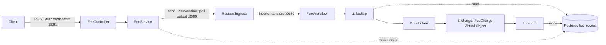

# fee-workflow

A Kotlin / Spring Boot 4 service: `POST /transaction/fee` takes a settled transaction, calculates its
fee, charges it once and records it, and `GET /transaction/{id}/fee` reads the result back. A Restate
workflow (server 1.8.1) drives the steps, and Postgres holds the fee records.

## Run

```sh
docker compose up --build
docker compose logs register   # wait until it shows "deployment registered"
```

Then send a transaction with a `transaction_id` that has not been sent before:

```sh
curl -s -X POST http://localhost:8081/transaction/fee -H 'content-type: application/json' -d '{
  "transaction_id": "txn_readme_001", "amount": 1000, "asset": "USD", "asset_type": "FIAT",
  "type": "Mobile Top Up", "state": "SETTLED - PENDING FEE", "created_at": "2023-08-30 15:42:17.610059"}'
```

```json
{"transaction_id":"txn_readme_001","amount":1000,"asset":"USD","type":"Mobile Top Up","fee":1.5,"rate":0.0015,"description":"Standard fee rate of 0.15%"}
```

Swagger UI: <http://localhost:8081/swagger-ui.html> (OpenAPI at `/v3/api-docs`), pre-filled with the
brief's sample. It is on in this compose demo and off by default everywhere else; `SPRINGDOC_ENABLED=true`
turns it on.

Resending the identical request returns the identical body and never charges twice. Resending the
same `transaction_id` with any field changed returns `409 Conflict`: pick a new id for a new transaction.

> **Warning:** `docker compose down -v` deletes the `restate-data` volume, which holds every charge
> (`FeeCharge` state and the workflow journals), as well as the Postgres volume. Use
> `docker compose down` without `-v` to keep them.

Ports: 8081 is the app's API and `/actuator/health`. Restate's ingress (8080), its admin API and UI
(9070) and Postgres (5433, override with `POSTGRES_PORT`) are bound to `127.0.0.1`. The app's Restate
SDK endpoint (9080) is not published: it is reachable on the compose network only.

## API

| Endpoint | Answers |
|---|---|
| `POST /transaction/fee` | **200** the fee body above; **202** after 10 s with `Location: /transaction/{id}/fee`, `Retry-After: 1` and `{"transaction_id":"…","status":"PROCESSING"}`; **400** invalid input; **409** same id, different payload; **500** the run ended with an untagged failure; logged; **503** Restate or the fee records unavailable, `Retry-After: 5` |
| `GET /transaction/{id}/fee` | **200** the same body as the POST; **202** still running; **400** bad id, or the workflow rejected the input; **404** unknown id; **409** the POST's conflict; **500** the run ended with an untagged failure; logged; **503** |

Every error is RFC 9457 `application/problem+json`, and a 400 lists every invalid field:

```json
{"type":"/problems/invalid-request","title":"Invalid request","status":400,
 "detail":"One or more fields are invalid.","instance":"/transaction/fee",
 "errors":[{"field":"amount","message":"must be greater than zero"}]}
```

## Tests

| Command | What it runs |
|---|---|
| `./mvnw -q verify` | The gate: 377 unit tests and 149 integration tests, including 122 Cucumber scenarios. Docker must be running (Testcontainers starts Postgres and Restate) |
| `./mvnw -q test` | Unit tests only; every `*IT` is skipped |
| `./scripts/smoke.sh` | `docker compose up --build`, every `api-tests/*.hurl` file against the stack, then `docker compose down` (volumes kept). `--keep` leaves the stack running |

Every acceptance criterion in `docs/requirements.md` (AC1–AC31) has a scenario tagged `@ACn`;
`TraceabilityTest` fails if one is missing. Full table: [`docs/plan.md` §6](docs/plan.md).

| Feature file (`src/test/resources/features/`) | ACs |
|---|---|
| `fee_calculation.feature` | AC1–AC5, AC20, AC24, AC25, AC30, AC31 |
| `money.feature` | AC8–AC12 (and AC5) |
| `transaction_types.feature` | AC13–AC15 |
| `validation.feature` | AC6, AC7, AC26, AC27 |
| `slow_workflow.feature` | AC28, AC29 |
| `idempotency.feature` | AC16–AC19 |
| `durability.feature` | AC21–AC23 |

### API smoke tests (Hurl)

`api-tests/` holds plain-text [Hurl](https://hurl.dev) files: each is a sequence of HTTP requests with
assertions on status, headers, JSON paths and the raw body. Every run uses a fresh `transaction_id`.
`./scripts/smoke.sh` uses a local `hurl` if installed, else the pinned image
`ghcr.io/orange-opensource/hurl:8.1.0`, so only Docker is needed. Against a stack that is already up:

```bash
hurl --test --variable base_url=http://localhost:8081 api-tests/*.hurl
```

The Cucumber features are the acceptance tests; the Hurl files check the composed stack a reviewer runs.

## Architecture



One `FeeWorkflow` runs per `transaction_id`. `lookup` returns a stored record for the id, if any;
`calculate` prices the fee; `FeeCharge` (one Virtual Object per `transaction_id`) mints the charge id
and keeps the charge in Restate state; `record` writes the `fee_record` row, its only writer.

Dependencies point one way: `api → service → domain`, `workflow → service, domain`,
`persistence → domain`, `config → domain`. `ArchitectureTest` (ArchUnit) enforces this, plus no `Double`/`Float` on the
money path, no `UUID.randomUUID`, `Instant.now` or `Clock.System` in `workflow`, and a single
writer of `fee_record`.

| Package | Holds |
|---|---|
| `api` | `FeeController`, request/response types, `FeeRequestValidationService` + `Impl`, `ApiExceptionHandler`, Jackson and OpenAPI config |
| `service` | `FeeService` / `FeeServiceImpl` (the use case), the `FeeWorkflowGateway` port, `GatewayFailureMappingService` + `Impl` |
| `workflow` | `FeeWorkflow`, `FeeCharge`, `RestateFeeWorkflowGateway` (the only class using the Restate client), journal types in `model/` |
| `domain` | `AssetRegistry` and `FeeSchedule` (interfaces with `Default…` implementations), fee rules, the services `FeeCalculationService`, `PayloadFingerprintService` and `FeeScheduleValidationService` (each with an `…Impl`), `Money(amount, asset)` (a value object that enforces its bounds), `Transaction` (built only through `TransactionFactory`, which returns a valid transaction or every violation), `DateFormatter` (a value helper), the `FeeRecordRepository` port; JDK and Kotlin stdlib only |
| `persistence` | the JPA entity and `JpaFeeRecordRepository` |
| `config` | `DomainConfig`: builds the Spring-free domain objects as Spring beans and validates the fee schedule at startup |

Naming rule: an interface is named after its role (`FeeService`, `FeeWorkflowGateway`), an
implementation after its technology (`RestateFeeWorkflowGateway`, `JpaFeeRecordRepository`), or `…Impl`
when there is none (`FeeServiceImpl`).

Business logic lives in services: a `…Service` interface with a `…ServiceImpl`, each unit-tested on
its own and replaceable by a fake in its callers' tests. Only a value helper (`DateFormatter`),
wire codecs and constants are Kotlin `object`s. `ArchitectureTest` enforces both rules.

## Design decisions

From `docs/requirements.md` §3 (D*n*) and `docs/plan.md` §1 (Q*n*).

| Decision | Rejected | Why |
|---|---|---|
| D1: a Spring controller calls the Restate ingress | the bare Restate ingress | exact path, number format, validation and 400/409/202/503 before any workflow exists |
| D2: the charge is a `FeeCharge` Virtual Object keyed by `transaction_id` | a Postgres ledger; a fake payments service | one writer per key and a journaled call, so Restate itself charges once |
| D2b: after the charge, retry then pause | a saga with refund | a short DB outage must not give up a correct charge; a paused invocation is visible and resumable |
| D4: Postgres (Flyway) is the system of record | Restate state only | records outlive Restate's retention and can be queried with SQL |
| D5: fee rules in a Kotlin registry (`FeeSchedule`) | YAML; a DB table | every rule change gets review and tests; rule id and version stored per record |
| D7: same id, different payload is 409, by SHA-256 fingerprint | return the original result | a changed payload under the same id is a caller bug |
| D9: HALF_UP once, at each asset's scale (USD 2, JPY 0, BTC 8, ETH 18) | HALF_EVEN; 2 decimals for all | matches a hand calculation and is correct for JPY and crypto |
| D11: wait 10 s, then 202 with a status link | 504 after 30 s; wait forever | nothing failed; answer before client or proxy timeouts |
| Q1: at most 20 integer digits in `amount`, checked before any arithmetic | no ceiling | fits `numeric(38,18)`; `1E+20000000` is never expanded |
| `FeeCharge` checks the payload fingerprint | trust the caller | a charge with no record still refuses a different payload (409) |
| The workflow re-checks its own input in `calculate` | trust the API | a `run` sent straight to the ingress cannot cause a charge the API would refuse |

## Configuration

| Key | Default |
|---|---|
| `server.port` | `${SERVER_PORT:8081}` |
| `spring.datasource.url` / `username` / `password` | `DB_URL` / `DB_USER` / `DB_PASSWORD` (defaults: `jdbc:postgresql://localhost:5433/fees`, `fees`, `fees`) |
| `spring.datasource.hikari.connection-timeout` | `2000` (ms) |
| `fees.sync-wait` | `10s`: how long POST waits before answering 202 |
| `spring.mvc.async.request-timeout` | `30s`; must exceed `fees.sync-wait` + 5 s, or `SyncWaitCheck` refuses startup |
| `restate.sdk.http.port` | `${RESTATE_SDK_PORT:9080}` |
| `restate.client.base-uri` | `${RESTATE_INGRESS_URL:http://localhost:8080}` |
| `restate.components.FeeCharge.ingress-private` | `true` |
| `springdoc.api-docs.enabled` / `springdoc.swagger-ui.enabled` | `${SPRINGDOC_ENABLED:false}`: off, since the API has no authentication; the compose demo and the `it` test profile set it to `true` |
| `springdoc.api-docs.path` / `springdoc.swagger-ui.path` | `/v3/api-docs` / `/swagger-ui.html` |
| `springdoc.model-converters.kotlin-nullable-property-customizer.enabled` | `false`: the request's fields are nullable in Kotlin only so the validator can list every missing one; the document shows each as required and never null |

## Operations

**Restate behaviours relied on** (server 1.8.1):
- one workflow run per `transaction_id`; `FeeCharge` Virtual Object state is kept indefinitely;
- workflow completion is retained for 1 day; after that, `lookup` and `FeeCharge` keep idempotency;
- journaled steps replay, so a fee already journaled survives a rule change;
- the retry policy's `max-attempts` counts the first attempt; when attempts run out the invocation
  pauses and is never killed (server default: 70 attempts, then pause); a paused invocation shows `status='paused'`
  in `sys_invocation`;
- resume is `PATCH /invocations/{id}/resume` on 9070 (409 while running); purge is
  `PATCH /invocations/{id}/purge`, on completed invocations only.

**Journal compatibility:** a fix deployed while a `FeeWorkflow` is paused must keep the step names,
their order and the journal JSON shapes (new fields only with defaults). Otherwise drain first.

**Stuck-charge runbook.** A `record` that keeps failing pauses the invocation, and GET answers 202.
Find unfinished runs with Restate's admin SQL on 9070:

```sql
SELECT id, target_service_name, target_service_key, status FROM sys_invocation
WHERE target_service_name IN ('FeeWorkflow','FeeCharge') AND status IN ('paused','backing-off')
```

Fix the cause, then resume each one. Never cancel or kill a `FeeWorkflow` that has passed `charge`,
and never press Cancel or Kill in the Restate UI.

## Assumptions

The brief left open questions; each is decided in `docs/requirements.md` §3 and `docs/plan.md` §1.
In short: the response's `rate` is `0` for flat and free fees; a fee larger than the amount is a 400;
`state` must be `SETTLED - PENDING FEE` and is stored as `SETTLED`; `created_at` is strict
(`yyyy-MM-dd HH:mm:ss.SSSSSS`, UTC); FIAT and CRYPTO are accepted with a per-asset scale;
`type`, `asset` and `asset_type` match case-sensitively; a fee that rounds to 0 is still charged;
two extra types (Bank Transfer, Charity Donation) show the extension point.

## In production I would

- add CI running `./mvnw -B verify` (backlog);
- test the workflow branches without Spring, with Restate's test SDK (backlog);
- add a GET branch for a run an operator cancelled or killed, which now answers 202 until retention
  ends (backlog);
- add authentication and rate limiting: there are none;
- protect the ingress and admin API by more than network placement, and turn on Restate request
  signing for the SDK port 9080 (not built);
- add metrics and dashboards (there are none).

## How this was built with AI

- Requirements and decisions came first, written with the author's answers to the open questions
  (`docs/requirements.md`).
- An implementation plan was reviewed twice by an adversarial plan review and approved before any
  code (`docs/plan.md`).
- The build ran in six vertical slices, each built by AI agents at a stated model tier, each verified
  with `./mvnw verify` and the smoke test, and each passed through an adversarial review gate whose
  findings were fixed or explained (as-built notes in `docs/plan.md` §5).
- The harness lives in `CLAUDE.md`.
